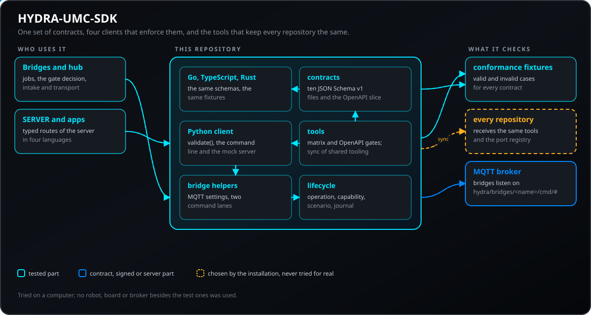
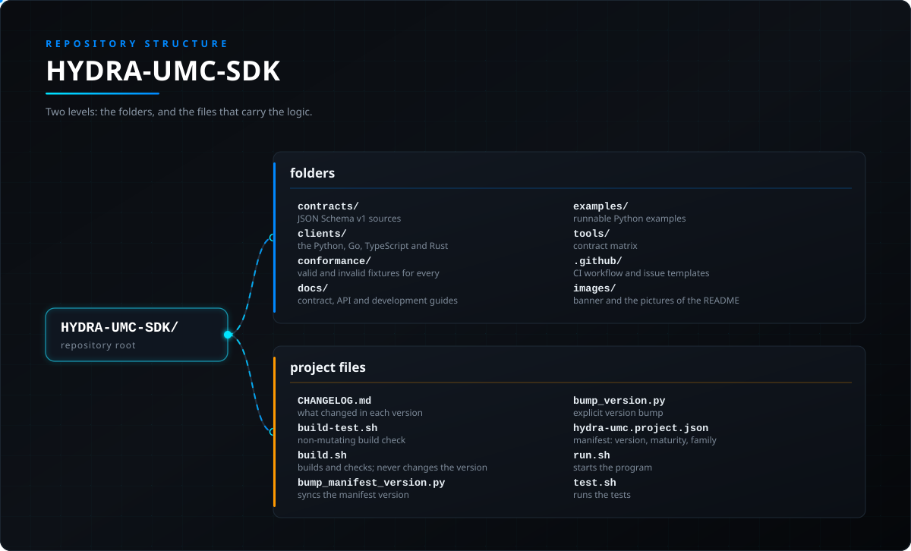

<!-- =============================================================================
HYDRA-UMC-SDK - Shared contracts and integration toolkit
Copyright (C) JuanenRac (Electro Hobby 3D) <electrohobby3d@gmail.com>
GPL-3.0-or-later - see LICENSE
============================================================================= -->

<p align="center">
  
</p>

# 🧰 HYDRA-UMC-SDK

<p align="center"><a href="README.md">🇺🇸 English</a> | <a href="README_spa.md">🇪🇸 Español</a> | <a href="README_fra.md">🇫🇷 Français</a> | 🇮🇹 <b>Italiano</b> | <a href="README_deu.md">🇩🇪 Deutsch</a> | <a href="README_zho.md">🇨🇳 简体中文</a> | <a href="README_jpn.md">🇯🇵 日本語</a> | <a href="README_por.md">🇵🇹 Português</a></p>

### 🧰 Contratti condivisi, client di riferimento e strumenti di integrazione per HYDRA-UMC

<p align="center">
  
  
  
  
  
  
  
</p>

---

> **Verifica di onestà - cosa funziona davvero oggi:** i diciotto contratti JSON Schema v1 con una fixture valida e una non valida ciascuno, il validatore Python, la prima porzione OpenAPI v1 di HYDRA-UMC-SERVER, i client Go, TypeScript e Rust che applicano gli stessi schemi, gli helper per bridge e la matrice di compatibilità sono reali e provati su un computer (675 test Python, più le suite degli altri tre client). Protobuf non è ancora pubblicato, il gate dei job è una funzione software condivisa e non una funzione di sicurezza certificata, e nulla di tutto ciò è stato eseguito su hardware reale.

---

> **Stato di sicurezza (safety e security):** questo ecosistema non è un sistema di sicurezza certificato. Non esiste ancora un percorso E-STOP hardware, né limiti o interblocchi imposti dal firmware, né un comando di movimento verificato; le immagini firmware sono controllate con CRC-32 e una firma Ed25519, e una compilazione di rilascio rifiuta le chiavi di sviluppo pubblicate (le teste utensile e le schede di espansione dietro il relè usano ancora i bootloader di URTC, che accettano un HMAC-SHA256 a chiave condivisa invece di una firma); TLS e TLS reciproco sono opzionali e disattivati per impostazione predefinita; nessuna scheda propria è stata ancora assemblata o provata. Leggi la [base di sicurezza](https://github.com/JuanenRac/HYDRA-UMC-DOCS/blob/main/docs/SECURITY_BASELINE.md) e il [modello delle minacce](https://github.com/JuanenRac/HYDRA-UMC-DOCS/blob/main/docs/THREAT_MODEL.md) prima di fidarti di qualsiasi affermazione qui per la sicurezza di una persona.

---

## 📋 In breve

| | |
|---|---|
| Versione | `0.4.2` |
| Maturità | Consolidato |
| Test | 675 (`python -m unittest discover -s clients/python/tests`) |
| Tecnologia | Python / TypeScript / Go / Rust / JSON Schema |
| Su hardware reale | Non ancora: per questa versione non risulta alcuna esecuzione su hardware reale |

**Vai a:** [Panoramica](#-panoramica) · [Architettura](#-architettura) · [Funzionalità](#-funzionalità) · [Sicurezza e protezione](#-sicurezza-e-protezione) · [Interfacce](#-interfacce) · [Configurazione](#-configurazione) · [Avvio rapido](#-avvio-rapido) · [Test](#-test) · [Risoluzione dei problemi](#-risoluzione-dei-problemi) · [Struttura del repository](#-struttura-del-repository) · [Progetti correlati](#-progetti-correlati)

## 🚦 Stato del progetto

Ogni riga è una parte di questo repository e il semaforo dice a che punto è oggi. È scritta in base a ciò che il repository può mostrare (test, compilazioni, esecuzioni), non a ciò che è previsto.

🟢 Fatto e verificato · 🟡 Funziona, con limiti noti · 🟠 Fatto a metà o non ancora verificato · 🔴 Non fatto o non funzionante

| Area | Stato | Cosa significa qui |
|---|---|---|
| Software | 🟢 | Completo per il suo scopo e stabile; la verifica di onestà qui sopra elenca i limiti noti |
| Test | 🟢 | 675 test automatici, eseguiti a ogni modifica |
| Hardware reale | 🔴 | Non ancora: per questa versione non risulta alcuna esecuzione su hardware reale |
| Documentazione | 🟢 | README in otto lingue, verificato rispetto al manifesto a ogni modifica |

## 🎯 Panoramica

HYDRA-UMC-SDK definisce il linguaggio stabile condiviso dai servizi HYDRA-UMC,
client, adattatori CM5 e integrazioni URTC. Possiede contratti normativi, un
validatore di riferimento Python senza dipendenze, fixture di conformità e
guida all'integrazione. Non sostituisce le API ufficiali per il sistema operativo Raspberry Pi, Hailo, ROS 2, MQTT, OPC-UA o
MTConnect.

## 🧩 Ruolo in HYDRA-UMC

**HYDRA-UMC-SDK** è il linguaggio comune dell'ecosistema: i contratti JSON Schema v1, la prima porzione OpenAPI del server, client di riferimento in Python, Go, TypeScript e Rust, gli helper per bridge che usano tutti i bridge e il connector hub, e gli strumenti che mantengono identici gli strumenti di ogni repository. Non esegue alcun servizio proprio e non sostituisce alcuna API ufficiale.

## 🏛️ Architettura

<p align="center">
  
</p>

## ✨ Funzionalità

### Stato

Contratti JSON Schema v1, fixture valide/non valide, un client di convalida Python,
e vengono implementati i test lato host, oltre a una vera prima porzione OpenAPI v1
per la superficie HTTP di HYDRA-UMC-SERVER (`contracts/openapi/v1/server.openapi.json`
- vedi [docs/CONTRACTS.md](docs/CONTRACTS.md#openapi-v1)). La pubblicazione Protobuf è un traguardo di compatibilità successivo; i client Go, TypeScript e Rust esistono già.

Una matrice di compatibilità reale e automatica (`tools/verify_contract_matrix.py`)
verifica incrociando ogni schema pubblicato con l'elenco dei contratti del
validatore Python stesso - ha individuato e corretto una lacuna reale in cui
`project-manifest.schema.json` (il contratto di `hydra-umc.project.json` che
ogni repository di questo ecosistema pubblica) non aveva alcuna voce di
validatore, e ora dimostra che ogni fixture di conformità viene giudicata
come afferma il proprio nome file, oltre ai casi di contratto sconosciuto e
versione di schema incompatibile.

Dal primo traguardo qui sotto sono stati aggiunti altri contratti (15 in totale): un
contratto pubblico di bridge verso macchine esterne
`BridgeJob`/`GateDecision` (vedi
[docs/BRIDGE_CONTRACT.md](docs/BRIDGE_CONTRACT.md)), condiviso da
`HYDRA-UMC-BRIDGE-ROS2`/`-OPENPNP`/`-PRINTER3D`/`-CNC`/`-LASER`/`-AMR`/`-DROIDS`/`-UAV` e dotato
di una propria forma JSON reale (`job_to_dict()`/`job_from_dict()`/
`decision_to_dict()`), più lo stato della macchina che il bridge stesso osserva, che la porta usa al posto di quello dichiarato da chi richiede, e un'ammissione dei lavori (`JobIntake`/`IdempotencyStore`) che ignora i messaggi trattenuti e non esegue mai due volte una chiave di idempotenza; un contratto `ScenarioOutcome` più
`compare_runs()`, una verifica condivisa "è stato davvero
risolto" che restituisce `apparent-success` (non `regression-fixed`)
quando un fallimento smette di riprodursi ma l'impronta di base non è
mai cambiata; un contratto `Operation` più
`validate_status_transition()`, il ciclo di vita condiviso di
obiettivo/lavoro/operazione - `received`/`authorized`/`queued`/`sent`/
`confirmed`/`terminated`/`rejected`, mai un unico contenitore
"eseguito"; un `result` opzionale su `Operation` più
`concludes_success()` - evidenza reale (`run_id`/`origin`/
`observers_enabled`/`outcome`) che rifiuta di concludere il successo a
partire da un risultato obsoleto/ripetuto o da un'esecuzione con
osservazione disattivata; un contratto `Capability` autonomo più
`is_capability_usable()` - il fatto che un target *dichiari* di
supportare un `kind` di operazione è modellato come dato distinto dal
fatto che quel supporto sia stato *recentemente e davvero verificato*
(`last_checked_at_utc`/`checked_configuration`/`max_age_seconds`), così
una capacità dichiarata ma mai verificata o ormai obsoleta non viene mai
trattata silenziosamente come utilizzabile; e un
`hydra-umc-sdk-mock-server`
(`mock_server.py`) che serve un payload di esempio valido per ogni
contratto noto via HTTP semplice, così una UI o un adattatore possono
essere sviluppati prima che esista un vero hardware CM5/robot/MCU. Tutti
e 15 i contratti hanno almeno una fixture di conformità valida e una non
valida, verificate dalla matrice di compatibilità sopra.

### Fonte delle route, contratti di messaggistica e trasporto dei ponti irrobustibile

- **Una fonte per un gruppo di route del server (pilota: le route delle connessioni):** `contracts/sources/connections.routes.json` dichiara `GET /api/connections/clients` e `GET /api/connections/events` (accesso, codici di stato, parametri di query) sopra gli schemi chiusi `ConnectionClient` e `ConnectionEvent`, e `python tools/contract_source.py` ne genera `contracts/openapi/v1/server.connections.openapi.json`. `--check` fallisce quando il documento generato è obsoleto, una copia inclusa degli schemi differisce o le route o le enumerazioni del server si discostano dalla fonte. Vedi [`docs/CONTRACT_SOURCE.md`](docs/CONTRACT_SOURCE.md).
- **Contratti di messaggistica:** `MqttPublish` porta un `qos` (0, 1 o 2) e `ProductionEvent` descrive un ciclo terminato (`source_id`, `at_utc`, `good`, `cycle_time_s`), che i rapporti di produzione trasformano in OEE.
- **Le route che il server ha aggiunto dopo il pilota, con contratti tipizzati:** `contracts/openapi/v1/server.full.openapi.json` elenca `GET /api/ecosystem/health`, `GET /api/robots/liveness`, `POST /api/robot/{id}/heartbeat`, `POST /api/stop-all/release`, le route delle connessioni e il `GET /health` pubblico, e la parte tipizzata descrive le prime quattro. Due nuovi contratti chiusi, `EcosystemHealth` (stato, codice del motivo e scarto di versione di ogni servizio e stato del certificato del server) e `RobotLiveness` (vivo, scaduto o sconosciuto per ogni robot), sono validati dal client Python e inclusi nei client Go, Rust e TypeScript con i loro hash, fixture e test differenziali. Vedi [`docs/CONTRACTS.md`](docs/CONTRACTS.md).
- **Un trasporto dei ponti irrobustibile, tutti i limiti disattivati per impostazione predefinita:** `MessageDispatcher(..., max_queue=N, max_payload_bytes=N)` limita i comandi in attesa dietro quello in corso (il più vecchio viene scartato e contato) e rifiuta un carico troppo grande; la corsia di arresto non è mai limitata e i verbi di arresto sono esenti dal tetto. `stats()` restituisce i contatori `dropped`, `oversized` e `queued`. `connect_with_retry` e `open_bridge_client` accettano un'attesa esponenziale con jitter per la prima connessione, e `reconnect_min_delay_seconds` / `reconnect_max_delay_seconds` impostano il ritardo di riconnessione del client MQTT. Vedi [`docs/PYTHON_CLIENT.md`](docs/PYTHON_CLIENT.md).

## 🔒 Sicurezza e protezione

| Minaccia | Difesa | Dove |
|---|---|---|
| Un comando di bridge fuori dal suo contratto | Un job porta al massimo 32 parametri, nomi di 64 caratteri, valori di 1024 e identificatori di 128; si usa lo stato macchina osservato dal bridge, non quello dichiarato dal richiedente | `bridge_contract.py` |
| Lo stesso comando eseguito due volte, o un messaggio trattenuto ripetuto | L'accettazione dei job ignora i messaggi trattenuti e non esegue mai due volte una chiave di idempotenza | `job_intake.py` |
| Uno stop che aspetta dietro un comando lungo | I comandi normali girano uno alla volta su una corsia e i verbi di stop su una seconda corsia | `bridge_transport.py` |
| Un diluvio di comandi, un payload enorme o un broker che resta spento | Limiti facoltativi, spenti per impostazione predefinita: una coda limitata che scarta il comando in attesa più vecchio e lo conta, un tetto alla dimensione del payload (verbi di stop esenti), backoff esponenziale con jitter alla prima connessione e limiti di riconnessione configurabili | `bridge_transport.py` |
| Credenziali del broker in un file di configurazione, o broker non verificato | Utente e password vengono dall'ambiente o da un file, TLS può verificare il broker con una CA, e un certificato client con la sua chiave attiva il TLS reciproco | `mqtt_connection.py` |
| Uno schema cambiato senza che il validatore lo segua | Una matrice di compatibilità controlla ogni schema pubblicato con l'elenco dei contratti del validatore e giudica ogni fixture da ciò che dice il nome del file | `tools/verify_contract_matrix.py` |

**Cosa non fa mai:** fare da funzione di sicurezza certificata. Il gate dei job è un'implementazione software condivisa dai bridge, non una certificazione di sicurezza.

## 🔌 Interfacce

| Topic o rotta | Cosa porta |
|---|---|
| `contracts/json-schema/v1/` | diciotto contratti JSON Schema v1: capacità, descrittore di dispositivo, busta di evento, rapporto di salute, operazione, manifesto di progetto, stato di sicurezza, esito di scenario, scoperta del server, manifesto di aggiornamento, client di connessione, evento di connessione, posa, evento di produzione, stato del robot, stato del gemello, salute dell'ecosistema, segnale di vita del robot |
| `contracts/openapi/v1/server.openapi.json` | la prima porzione OpenAPI v1 di HYDRA-UMC-SERVER: scoperta, accesso, impostazioni e comandi (un sottoinsieme del `docs/openapi.json` del server stesso) |
| `contracts/ports.yaml` | il registro di porta, percorso di salute e unità systemd di ogni servizio, generato da `tools/sync_ports.py` |
| `hydra/bridges/<name>/cmd/#` | dove ascolta un bridge; risponde su `.../<verbo>/result` |
| `hydra-umc-contract-validate`, `hydra-umc-sdk-mock-server` | il validatore da riga di comando (codice di uscita 2 in caso di errore) e un server simulato su `127.0.0.1:8790` che serve un esempio valido per contratto |

## ⚙️ Configurazione

| Variabile | Predefinito | Cosa imposta |
|---|---|---|
| `HYDRA_MQTT_USERNAME`, `HYDRA_MQTT_PASSWORD` | nessuna credenziale | la credenziale del broker; la password solo insieme al nome utente |
| `HYDRA_MQTT_PASSWORD_FILE` | - | la password letta da un file (un secret di Docker o systemd); ignorata se la variabile sopra è impostata |
| `HYDRA_MQTT_TLS`, `HYDRA_MQTT_TLS_CA` | nessun TLS | `HYDRA_MQTT_TLS=1` verifica il broker con le CA di sistema; `HYDRA_MQTT_TLS_CA` indica il file della CA che ha firmato il suo certificato |
| `HYDRA_MQTT_TLS_CERT`, `HYDRA_MQTT_TLS_KEY` | - | il certificato client e la sua chiave per un broker che richiede TLS reciproco; servono entrambi e attivano TLS |
| `--host`, `--port` | `127.0.0.1`, `8790` | dove ascolta il server simulato |
| `HYDRA_UMC_SDK_ROOT` | la cartella accanto | dove i test degli altri repository trovano questo |

## 🚀 Avvio rapido

Richiede Python 3.11 o successivo. Anche i client Go, TypeScript e Rust vengono compilati e testati se la loro toolchain è installata.

```bash
PYTHONPATH=clients/python/src python -m unittest discover -s clients/python/tests  # the Python client tests
python tools/verify_contract_matrix.py                                             # every schema against the validator and every fixture
PYTHONPATH=clients/python/src python -m hydra_umc_sdk.validation --help            # the contract validator on the command line
./build-test.sh                                                                    # the non-mutating build check (build-test.bat on Windows)
```

## 🧪 Test

675 test automatici si eseguono con `python -m unittest discover -s clients/python/tests`. Gli altri client hanno le proprie suite: 28 test in Go (`go test ./...`), 121 in TypeScript (`npm test`) e 31 in Rust (`cargo test`), eseguiti da `tools/extra_build_steps.py` se la toolchain è installata. Nessuno richiede hardware.

La CI esegue `HYDRA_UMC_CI=1 python tools/ci_validate.py`, che controlla il manifesto, i documenti, gli otto README e le immagini.

## 🏗️ Compilazione e rilascio

Usa il controllo di compilazione senza versionamento prima di una compilazione di rilascio:

| Azione | Windows | Linux / macOS |
|---|---|---|
| Controllo di compilazione (senza modificare versione o CHANGELOG) | `build-test.bat` | `./build-test.sh` |
| Esecuzione / sviluppo (se disponibile) | `run*.bat` o `dev*.bat` | `./run*.sh` o `./dev*.sh` |

`build-test.bat` e `build-test.sh` compilano o convalidano lo stack del progetto senza incrementare `hydra-umc.project.json` né modificare `CHANGELOG.md`. Possono creare solo i normali output del compilatore. Gli script esistenti `build*.bat`, `build*.sh`, `run*` e `dev*` mantengono il comportamento specifico di versione o esecuzione; usali quando tale comportamento è necessario.

## 🩺 Risoluzione dei problemi

| Vedi | Perché | Fai |
|---|---|---|
| `hydra-umc-contract-validate: missing required field: ...` | Il payload viola il contratto; il comando termina con codice di uscita 2 | Confronta il file con l'esempio che il server simulato serve per quel contratto |
| `verify_contract_matrix.py` fallisce | Uno schema è stato aggiunto o cambiato senza aggiornare l'elenco dei contratti del validatore o una fixture | Aggiungi la voce del validatore e una fixture valida e una non valida |
| `go test ./...` viene saltato | Il controllo di build esegue i client Go, TypeScript e Rust solo se `go`, `npm` e `cargo` sono nel PATH | Installa la toolchain; il controllo stampa quale client è stato saltato |

## 📂 Struttura del repository

<p align="center">
  
</p>

<details>
<summary>Versione testuale dell'albero</summary>

```text
HYDRA-UMC-SDK/
├── contracts/                 sorgenti JSON Schema v1, porzione OpenAPI e registro delle porte
├── clients/                   i client di riferimento in Python, Go, TypeScript e Rust
├── conformance/               fixture valide e non valide per ogni contratto
├── docs/                      guide su contratti, API e sviluppo
├── examples/                  esempi Python eseguibili
├── tools/                     matrice dei contratti, gate OpenAPI, sincronizzazione degli strumenti, controllo di build
├── .github/                   workflow di CI e modelli di segnalazione
├── images/                    banner e immagini del README
├── CHANGELOG.md               cosa è cambiato in ogni versione
├── build-test.sh              controllo di build senza modifiche
├── build.sh                   compila e controlla; non cambia mai la versione
├── bump_manifest_version.py   sincronizza la versione del manifesto
├── bump_version.py            aumento di versione esplicito
├── hydra-umc.project.json     manifesto: versione, maturità, famiglia
├── run.sh                     avvia il programma
└── test.sh                    esegue i test
```

</details>

`tools/`: `verify_contract_matrix.py` (matrice di compatibilità schema/validatore), `verify_openapi.py` (validazione strutturale OpenAPI senza dipendenze) e il motore non distruttivo di `build-test`. `sync_repo_tools.py` mantiene identici gli strumenti condivisi di tutti i repository, `pin_sdk.py` fissa i consumatori dell'SDK a un tag di versione e `canonical/` contiene le copie uniche che vengono replicate (tra cui il comando `hydra_project_tool.py`, che convalida, collauda e cambia la versione solo se richiesto). `sync_ports.py` genera e controlla `contracts/ports.yaml`, il registro di porta, percorso di salute e unità systemd di ogni servizio; l'oscuramento condiviso dei segreti (`canonical/redaction.py`, con i suoi casi in `contracts/redaction/vectors.json`) è copiato nei progetti che inviano testo all'esterno.

## 🗺️ Roadmap e limiti noti

**Limiti noti oggi**

* Protobuf non è ancora pubblicato, e la porzione OpenAPI copre solo scoperta, accesso, impostazioni e comandi.
* Le rotte del server oggi non sono versionate; `/api/v1` è l'obiettivo di progetto descritto in `docs/API_DESIGN.md`.
* Nulla di tutto ciò è stato eseguito su hardware reale, e il gate dei job è una funzione software, non una funzione di sicurezza certificata.

**Prossimo passo:** pubblicare Protobuf dove un'integrazione lo richiede ed estendere la porzione OpenAPI al resto delle rotte del server.

## 🌍 Lingue

Questo README e i documenti del repository esistono in otto lingue: inglese, spagnolo, tedesco, francese, italiano, giapponese, cinese e portoghese (Portogallo). Sono scritti insieme e la CI verifica che gli otto file abbiano le stesse sezioni e gli stessi link. Questo repository non ha uno schermo né un catalogo di messaggi propri, quindi non ci sono stringhe di interfaccia da tradurre.

## 🔗 Progetti correlati

Questo progetto fa parte dell'ecosistema robotico HYDRA-UMC dello stesso autore (JuanenRac / Electro Hobby 3D). Vale la pena conoscerlo, poiché una richiesta potrebbe in realtà riguardare uno di questi invece di questo repository.

**Progetto Padre**
- **[HYDRA-UMC-OS](https://github.com/JuanenRac/HYDRA-UMC-OS)** — livello prodotto riproducibile su Raspberry Pi OS per il CM5: agente in sola lettura, config/profili validati, provisioning WiFi al primo contatto; un agente dispositivo consumatore dei propri contratti di dispositivo, salute, sicurezza e aggiornamento di questo SDK.
- **[HYDRA-UMC-CONNECTOR-HUB](https://github.com/JuanenRac/HYDRA-UMC-CONNECTOR-HUB)** — registro dichiarativo e validatore di manifesti adattatore per connettori di macchine esterne; estende la propria idea di contratto dell'SDK alle macchine esterne senza sostituire i progetti di gateway industriale.

**Direttamente Correlati**
- **[HYDRA-UMC-SERVER](https://github.com/JuanenRac/HYDRA-UMC-SERVER)** — il vero backend headless (REST/WebSocket) con cui parla davvero ogni client di controllo — un produttore e consumatore API autenticato governato dai propri contratti di questo SDK.
- **[HYDRA-UMC-UPDATER](https://github.com/JuanenRac/HYDRA-UMC-UPDATER)** — strumento amministrativo desktop che scopre, clona e aggiorna ogni repository di questo ecosistema — pubblica metadati di versione e compatibilità consumati dai propri client di questo SDK consapevoli del contratto.
- **[HYDRA-UMC-OS-REBUILDER](https://github.com/JuanenRac/HYDRA-UMC-OS-REBUILDER)** — strumento desktop Windows/Linux che costruisce un'immagine della CM5 pronta da scrivere, precaricata con le versioni più aggiornate dell'ecosistema, con configurazione di primo avvio Wi-Fi/utente/SSH in stile Raspberry Pi Imager.
- **[HYDRA-UMC-OPS-AGENT](https://github.com/JuanenRac/HYDRA-UMC-OPS-AGENT)** — coordinatore di incidenti di manutenzione: un ruolo edge a basso privilegio raccoglie uno snapshot di inventario/salute sanificato, un ruolo control-plane lo rende in sola lettura e chiede a un provider di IA di suggerire una diagnosi - non applica mai una patch né distribuisce nulla.
- **[HYDRA-UMC-DEV-SERVER](https://github.com/JuanenRac/HYDRA-UMC-DEV-SERVER)** — host di sviluppo riproducibile (Raspberry Pi 5 / CM5) che conserva il codice sorgente dell'ecosistema ed esegue attività delimitate di build/test tramite una coda durevole; un ruolo di sviluppo dedicato, esplicitamente distinto da un CM5 operativo.
- **[HYDRA-UMC-DOCS](https://github.com/JuanenRac/HYDRA-UMC-DOCS)** — il centro di documentazione e strumenti dell'ecosistema: architettura, interfacce, base di sicurezza, matrice delle capacità e un catalogo dei progetti generato da ogni manifesto.
- **[HYDRA-UMC](https://github.com/JuanenRac/HYDRA-UMC)** — il progetto della scheda madre del braccio robotico: host CM5 + coprocessore STM32H745 dual-core, pensato per coordinare fino a 8 bracci utensile via CAN-OTA/SPI-OTA (firmware in fase iniziale; nessuna scheda assemblata per ora).
- **[URTC](https://github.com/JuanenRac/URTC)** — firmware per la scheda fisica dell'Universal Robot Tool Controller, oltre 25 profili utensile su bus CAN — una piattaforma di controllo utensili indipendente collegata attraverso i propri adattatori di integrazione versionati di questo SDK.
- **[HYDRA-UMC-BRIDGE-ROS2](https://github.com/JuanenRac/HYDRA-UMC-BRIDGE-ROS2)** — coordinatore con un trasporto ROS 2 rclpy importato in modo lazy (non ancora eseguito contro un'installazione ROS 2) — utilizza la propria barriera comune BridgeJob di questo SDK per l'osservazione, l'ispezione e il lavoro di cella annullabile ROS 2.
- **[HYDRA-UMC-BRIDGE-OPENPNP](https://github.com/JuanenRac/HYDRA-UMC-BRIDGE-OPENPNP)** — coordinatore ad alto livello sicuro per il flusso schede del pick-and-place OpenPnP — utilizza i propri lavori correlati e idempotenti di questo SDK per passaggi di consegne PCB tracciabili.
- **[HYDRA-UMC-BRIDGE-PRINTER3D](https://github.com/JuanenRac/HYDRA-UMC-BRIDGE-PRINTER3D)** — barriera di coordinamento sicura per stampanti 3D Moonraker/Klipper, con comandi di lavoro reali e controllati — utilizza la propria barriera di questo SDK attorno alla prontezza nativa della stampante; non espone il controllo di riscaldatore o movimento.
- **[HYDRA-UMC-BRIDGE-CNC](https://github.com/JuanenRac/HYDRA-UMC-BRIDGE-CNC)** — coordinatore ad alto livello per celle CNC con accesso a stato/byte di controllo GRBL (testato solo contro un emulatore) — utilizza la propria barriera di questo SDK per coordinare solo accanto a un CNC inattivo e protetto.
- **[HYDRA-UMC-BRIDGE-LASER](https://github.com/JuanenRac/HYDRA-UMC-BRIDGE-LASER)** — coordinatore per celle laser che legge 3 segnali GPIO di chiave/involucro/interblocco (testato solo contro un chip simulato; non può armare né far partire un laser) — utilizza la propria barriera di questo SDK per gli ausiliari, preservando l'autorità di sicurezza del laser.
- **[HYDRA-UMC-BRIDGE-AMR](https://github.com/JuanenRac/HYDRA-UMC-BRIDGE-AMR)** — barriera di coordinamento per flotte AGV/AMR tramite un publisher MQTT VDA 5050 (testato solo contro una flotta emulata) — valida anch'esso i propri comandi contro questa stessa barriera condivisa di lavoro e sicurezza.
- **[HYDRA-UMC-BRIDGE-DROIDS](https://github.com/JuanenRac/HYDRA-UMC-BRIDGE-DROIDS)** — barriera di coordinamento per droidi con zampe/umanoidi, con un mittente di comandi per Boston Dynamics Spot (testato solo contro un emulatore) — valida anch'esso i propri comandi contro questa stessa barriera condivisa di lavoro e sicurezza.
- **[HYDRA-UMC-BRIDGE-UAV](https://github.com/JuanenRac/HYDRA-UMC-BRIDGE-UAV)** — barriera di coordinamento per UAV dotati di fotocamera, con un mittente di comandi MAVLink (testato solo contro un emulatore) — valida anch'esso i propri comandi contro questa stessa barriera condivisa di lavoro e sicurezza.

**Fa Anche Parte dell'Ecosistema**

*Backend Centrale e Client*
- **[HYDRA-UMC-STUDIO](https://github.com/JuanenRac/HYDRA-UMC-STUDIO)** — dashboard di controllo web con visualizzazione 3D multi-robot in tempo reale.
- **[HYDRA-UMC-SUITE](https://github.com/JuanenRac/HYDRA-UMC-SUITE)** — centro di comando sciame desktop (PySide6) per più server contemporaneamente, pacchettizzato come eseguibile standalone.
- **[HYDRA-UMC-ANDROID-CONTROL](https://github.com/JuanenRac/HYDRA-UMC-ANDROID-CONTROL)** — app di controllo nativa per Android con login biometrico e un companion Wear OS abbinato.
- **[HYDRA-UMC-IOS-CONTROL](https://github.com/JuanenRac/HYDRA-UMC-IOS-CONTROL)** — app di controllo per iOS/iPadOS (Flutter) con sincronizzazione WebSocket in tempo reale.
- **[HYDRA-UMC-DSI](https://github.com/JuanenRac/HYDRA-UMC-DSI)** — interfaccia touch nativa per il touchscreen DSI da 7" a bordo, incorporata direttamente nel CM5.
- **[HYDRA-UMC-EDITOR-URDF](https://github.com/JuanenRac/HYDRA-UMC-EDITOR-URDF)** — creatore/editor grafico desktop di URDF che invia i modelli finiti al catalogo di STUDIO.
- **[HYDRA-UMC-EDITOR-STL](https://github.com/JuanenRac/HYDRA-UMC-EDITOR-STL)** — editor desktop di modelli STL, che trasforma/sostituisce/rimuove/aggiunge veri pezzi nello stesso catalogo di modelli modificato anche da HYDRA-UMC-EDITOR-URDF.

*Piattaforma Strumenti URTC*
- **[URTC-FLASHER](https://github.com/JuanenRac/URTC-FLASHER)** — strumento desktop con GUI per il flashing delle schede URTC, CAN-OTA più SWD/JTAG a chip intero.
- **[URTC-TESTER](https://github.com/JuanenRac/URTC-TESTER)** — strumento desktop di diagnostica CAN-bus dal vivo per schede URTC, un pannello per profilo utensile.
- **[URTC-WEB-STUDIO](https://github.com/JuanenRac/URTC-WEB-STUDIO)** — alternativa basata su browser a URTC-TESTER tramite la Web Serial API, senza installazione locale.
- **[URTC-GATEWAY](https://github.com/JuanenRac/URTC-GATEWAY)** — gateway davanti al bus CAN di URTC: elenco di identificatori consentiti, limite di frequenza e chiave di sessione; software provato su computer, non ancora su un bus reale.

*Nodo IA Visione (Hailo-8)*
- **[HYDRA-UMC-VISION-NODE](https://github.com/JuanenRac/HYDRA-UMC-VISION-NODE)** — hub di integrazione per la pipeline di visione Hailo-8, con un vero controllo di prontezza hardware per fase.
- **[HYDRA-UMC-DETECTION-HEF](https://github.com/JuanenRac/HYDRA-UMC-DETECTION-HEF)** — registro reale di modelli compilati con verifica di caricamento sicuro per architettura Hailo/checksum.
- **[HYDRA-UMC-VISION-STREAMER](https://github.com/JuanenRac/HYDRA-UMC-VISION-STREAMER)** — generatore reale di pipeline GStreamer + config MediaMTX, con una vera barriera di integrazione HailoRT.
- **[HYDRA-UMC-VISUAL-SERVOING-API](https://github.com/JuanenRac/HYDRA-UMC-VISUAL-SERVOING-API)** — legge di correzione Position-Based Visual Servoing con autorizzazione condizionata allo stato di zona; ancora nessuna stima di posa da telecamera.
- **[HYDRA-UMC-SAFETY-ZONES](https://github.com/JuanenRac/HYDRA-UMC-SAFETY-ZONES)** — logica v0 di violazione zona, freschezza di calibrazione e richiesta E-STOP che legge le posizioni degli oggetti da un file; nessun rilevatore la alimenta e nessun E-STOP fisico è ancora collegato.

*Nodo IA Cognitivo (Hailo-10)*
- **[HYDRA-UMC-COGNITIVE-NODE](https://github.com/JuanenRac/HYDRA-UMC-COGNITIVE-NODE)** — hub di integrazione per la pipeline cognitiva Hailo-10 (orchestrazione LLM/VLA/voce).
- **[HYDRA-UMC-VLA-ENGINE](https://github.com/JuanenRac/HYDRA-UMC-VLA-ENGINE)** — vera codifica/decodifica di token d'azione e generazione di traiettoria per un modello Vision-Language-Action.
- **[HYDRA-UMC-VOICE-UI](https://github.com/JuanenRac/HYDRA-UMC-VOICE-UI)** — vero front-end vocale (VAD + parser di intenti) con un relay verso Watch limitato e soggetto a conferma.
- **[HYDRA-UMC-SEMANTIC-PLANNER](https://github.com/JuanenRac/HYDRA-UMC-SEMANTIC-PLANNER)** — vera scomposizione dei task basata su regole e recupero semantico degli errori sui codici errore MCU.
- **[HYDRA-UMC-DOCS-QA](https://github.com/JuanenRac/HYDRA-UMC-DOCS-QA)** — vera ricerca documentale TF-IDF (solo libreria standard) sui documenti Markdown di questo ecosistema.
- **[HYDRA-UMC-LOCAL-TECHNICIAN](https://github.com/JuanenRac/HYDRA-UMC-LOCAL-TECHNICIAN)** — tecnico di manutenzione IA locale e con cancelli di policy per l'ecosistema stesso - osserva, diagnostica e propone correzioni; i due livelli di rischio più alti non sono deliberatamente ancora implementati.

*Orchestrazione e Sciame*
- **[HYDRA-UMC-ORCHESTRATOR](https://github.com/JuanenRac/HYDRA-UMC-ORCHESTRATOR)** — hub di integrazione con un vero contratto di health-report gRPC/Protobuf e una macchina a stati di missione.
- **[HYDRA-UMC-JOB-DISPATCHER](https://github.com/JuanenRac/HYDRA-UMC-JOB-DISPATCHER)** — vera coda di lavori basata su priorità con deduplicazione, su una vera API HTTP.
- **[HYDRA-UMC-NODE-HEALING](https://github.com/JuanenRac/HYDRA-UMC-NODE-HEALING)** — vero watchdog di salute della flotta basato su gRPC, con retry/backoff e rilevamento di discrepanza d'identità.
- **[HYDRA-UMC-PATH-PLANNER-3D](https://github.com/JuanenRac/HYDRA-UMC-PATH-PLANNER-3D)** — vero pianificatore di percorsi 3D basato su RRT, con vera validazione delle collisioni ostacolo/spazio di lavoro.
- **[HYDRA-UMC-SWARM-SYNC](https://github.com/JuanenRac/HYDRA-UMC-SWARM-SYNC)** — vera sincronizzazione di stato CRDT LWW-Element-Map, con property test per la convergenza multi-cella.

*Gemello Digitale e Simulazione*
- **[HYDRA-UMC-TWIN](https://github.com/JuanenRac/HYDRA-UMC-TWIN)** — hub di integrazione per il motore di gemello digitale, con un vero contratto di sincronizzazione per compatibilità di versione.
- **[HYDRA-UMC-HIL-BRIDGE](https://github.com/JuanenRac/HYDRA-UMC-HIL-BRIDGE)** — router hardware-in-the-loop con un interblocco software di collisione tra simulazione e hardware reale (testato senza hardware reale).
- **[HYDRA-UMC-PHYSICS-REPLICA](https://github.com/JuanenRac/HYDRA-UMC-PHYSICS-REPLICA)** — vera cinematica diretta e validazione dei limiti articolari su un vero sottoinsieme URDF.
- **[HYDRA-UMC-SYNTHETIC-DATA-GEN](https://github.com/JuanenRac/HYDRA-UMC-SYNTHETIC-DATA-GEN)** — vero generatore procedurale di scene 2D con esportazione di annotazioni YOLO/COCO.

*Dati e Analisi*
- **[HYDRA-UMC-DATALAKE](https://github.com/JuanenRac/HYDRA-UMC-DATALAKE)** — vero archivio di serie temporali basato su sqlite3, con una vera API HTTP di ingestione/query.
- **[HYDRA-UMC-ANOMALY-DETECTOR](https://github.com/JuanenRac/HYDRA-UMC-ANOMALY-DETECTOR)** — vero rilevatore di anomalie FFT + baseline statistica, con monitoraggio della deriva.
- **[HYDRA-UMC-PRODUCTION-REPORTS](https://github.com/JuanenRac/HYDRA-UMC-PRODUCTION-REPORTS)** — vero calcolo OEE/disponibilità sullo storico di DATALAKE, con esportazione CSV riproducibile.
- **[HYDRA-UMC-TELEMETRY-COLLECTOR](https://github.com/JuanenRac/HYDRA-UMC-TELEMETRY-COLLECTOR)** — vera pipeline di ingestione CAN/WebSocket verso DATALAKE, con deduplicazione per sequenza.

*Gateway Industriale*
- **[HYDRA-UMC-GATEWAY-INDUSTRIAL](https://github.com/JuanenRac/HYDRA-UMC-GATEWAY-INDUSTRIAL)** — hub di integrazione che inoltra ai protocolli industriali, con un vero livello di allowlist dei comandi/backpressure.
- **[HYDRA-UMC-OPCUA-SERVER](https://github.com/JuanenRac/HYDRA-UMC-OPCUA-SERVER)** — vero spazio di indirizzi OPC-UA, verificato con una vera sessione client del protocollo binario.
- **[HYDRA-UMC-MQTT-BROKER](https://github.com/JuanenRac/HYDRA-UMC-MQTT-BROKER)** — vero broker MQTT con autenticazione opzionale per client e ACL sui topic.
- **[HYDRA-UMC-MTCONNECT-ADAPTER](https://github.com/JuanenRac/HYDRA-UMC-MTCONNECT-ADAPTER)** — veri endpoint XML `/probe` e `/current` di MTConnect, con output in modalità degradata.

*Strumenti Complementari e Operazioni dell'Ecosistema*
- **[HYDRA-UMC-DASHBOARD-AI](https://github.com/JuanenRac/HYDRA-UMC-DASHBOARD-AI)** — pannelli Smart Summaries e Anomaly Highlighting su DATALAKE/ANOMALY-DETECTOR, con un fallback statistico onesto.
- **[HYDRA-UMC-TOOL-CLI](https://github.com/JuanenRac/HYDRA-UMC-TOOL-CLI)** — CLI di flotta con un vero e stabile contratto di exit-code, un client live reale della stessa API di HYDRA-UMC-SERVER.
- **[HYDRA-UMC-WATCH](https://github.com/JuanenRac/HYDRA-UMC-WATCH)** — app companion WearOS con schemi di avviso aptico e un relay vocale verso il telefono abbinato (non ancora eseguita su un orologio fisico).
- **[URTC-SMART-RACK](https://github.com/JuanenRac/URTC-SMART-RACK)** — firmware per un rack di montaggio schede con decodifica reale dell'ID utensile e logica di preriscaldamento Smart Idle.
- **[URTC-VISION-TOOL](https://github.com/JuanenRac/URTC-VISION-TOOL)** — firmware più un vero companion di visione Python per una testa utensile di ispezione termica/RGB.

## 📚 Documentazione

Dove leggere di più:

* [Base di sicurezza dell'ecosistema](https://github.com/JuanenRac/HYDRA-UMC-DOCS/blob/main/docs/SECURITY_BASELINE.md)
* [Modello delle minacce dell'ecosistema](https://github.com/JuanenRac/HYDRA-UMC-DOCS/blob/main/docs/THREAT_MODEL.md)
* [Registro delle modifiche di questo repository](CHANGELOG.md)
* [Licenza di questo repository](LICENSE.md)

## 🤝 Contribuire e comunità

* Prima di una pull request esegui `HYDRA_UMC_CI=1 py -3 tools/ci_validate.py` (oppure `HYDRA_UMC_CI=1 python3 tools/ci_validate.py`): deve stampare `CI_VALIDATION=PASS`. Non eseguire `build.sh` né `build.bat` per questa verifica; compilare non è verificare.
* I otto README sono scritti da un'unica fonte in HYDRA-UMC-DOCS; non modificarli a mano. Cambia la fonte e riscrivili con `tools/make_readmes.py`.
* Non affermare in un README ciò che non è stato eseguito: scrivi «simulato» o «non provato su hardware» quando è la verità.
* Vedi [CONTRIBUTING.md](CONTRIBUTING.md), il [codice di condotta](CODE_OF_CONDUCT.md), [SECURITY.md](SECURITY.md) e [SUPPORT.md](SUPPORT.md).

## 👤 AUTORE

**JuanenRac (Electro Hobby 3D)** · electrohobby3d@gmail.com

## 📜 LICENZA

GPL-3.0-or-later - [LICENSE](LICENSE).
