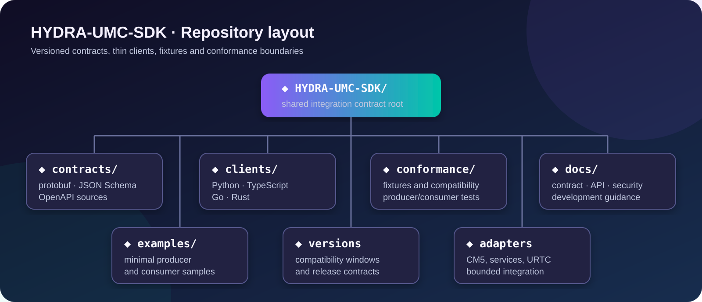

<!--
=====================================================================
HYDRA-UMC-SDK - 公的契約および統合ツールキットの概要
Copyright (C) 2026 JuanenRac (エレクトロホビー 3D) <electrohobby3d@gmail.com>
CC BY-SA 4.0 - LICENSE.md を参照
=====================================================================
-->

  

  <a href="README.md">🇺🇸 English</a> |
  <a href="README_spa.md">🇪🇸スペイン語</a> |
  <a href="README_fra.md">🇫🇷 フランス語</a> |
  <a href="README_ita.md">🇮🇹 イタリアーノ</a> |
  <a href="README_deu.md">🇩🇪 ドイツ語</a> |
  <a href="README_zho.md">🇨🇳 简体中文</a> |
  <a href="README_jpn.md">🇯🇵 日本語</a> |
  <a href="README_por.md">🇵🇹 Português</a>

  
  
  
  

# HYDRA-UMC-SDK

> **安全性とセキュリティの現状:** このエコシステムは認証された安全システムではありません。ハードウェアの E-STOP 経路、ファームウェアが強制する制限やインターロック、検証済みの動作コマンドはまだありません。ファームウェアイメージは CRC32 と共有鍵の HMAC-SHA256 で検査しており、非対称署名ではありません。TLS と相互 TLS は任意で、既定では無効です。独自基板はまだ実装も試験もされていません。ここに書かれた内容を人の安全のために頼る前に、[セキュリティベースライン](https://github.com/JuanenRac/HYDRA-UMC-DOCS/blob/main/docs/SECURITY_BASELINE.md)と[脅威モデル](https://github.com/JuanenRac/HYDRA-UMC-DOCS/blob/main/docs/THREAT_MODEL.md)をお読みください。

## 📋 ひと目で

| | |
|---|---|
| バージョン | `0.3.7` |
| 成熟度 | 確立 |
| 技術 | Python / TypeScript / Go / Rust / JSON Schema |
| 実機での確認 | まだです：このバージョンについて実機での動作記録はありません |

## 🚦 プロジェクトの状況

各行はこのリポジトリの一部分で、信号は今日どこまで進んでいるかを示します。計画ではなく、リポジトリが示せるもの（テスト、ビルド、実行）に基づいて書かれています。

🟢 完了・検証済み · 🟡 動作する（既知の制限あり） · 🟠 一部のみ、または未検証 · 🔴 未実装または動作しない

| 領域 | 状態 | ここでの意味 |
|---|---|---|
| ソフトウェア | 🟢 | 目的に対して完成していて安定しています。既知の制限は上の正直さの確認に書かれています |
| テスト | 🟠 | このリポジトリのテスト件数はまだ記録されていません |
| 実機 | 🔴 | まだです：このバージョンについて実機での動作記録はありません |
| ドキュメント | 🟢 | 8 言語の README。変更のたびにマニフェストと照合されます |

## 🧩 HYDRA-UMC の共有コントラクトと統合ツールキット

HYDRA-UMC-SDK は、HYDRA-UMC サービス、クライアント、CM5 アダプター、および
URTC 統合によって共有される安定した言語を定義します。規範的な契約、
依存関係のない Python 参照バリデータ、適合フィクスチャ、
統合ガイダンスを備えています。Raspberry Pi OS、Hailo、ROS 2、MQTT、OPC-UA、
MTConnect の公式 API を置き換えるものではありません。

## 🚧 ステータス

JSON スキーマ v1 コントラクト、有効/無効なフィクスチャ、Python 検証クライアント、
ホスト側のテスト、そして HYDRA-UMC-SERVER 自身の HTTP サーフェスに対する実際の
最初の OpenAPI v1 スライス（`contracts/openapi/v1/server.openapi.json` -
[docs/CONTRACTS.md](docs/CONTRACTS.md#openapi-v1) 参照）が実装されています。
Protobuf の公開はその後の互換性マイルストーンです。Go、TypeScript、Rust のクライアントはすでにあります。

実際に動作する自動互換性マトリクス（`tools/verify_contract_matrix.py`）は、公開されているすべてのスキーマを Python バリデータ自身のコントラクト一覧と突き合わせて検証します。これにより、`project-manifest.schema.json`（このエコシステムの各リポジトリが公開する `hydra-umc.project.json` のコントラクト）にバリデータのエントリが一つも存在しないという実際のギャップを発見し、修正しました。現在では、各適合フィクスチャがそのファイル名どおりに判定されること、さらに未知のコントラクトおよび非互換なスキーマバージョンのケースについても正しく判定されることを証明しています。

下記の最初のマイルストーン以降、さらにコントラクトが追加されました(現在10件)。外部マシン連携のための公開コントラクト `BridgeJob`/`GateDecision`(詳細は [docs/BRIDGE_CONTRACT.md](docs/BRIDGE_CONTRACT.md))は `HYDRA-UMC-BRIDGE-ROS2`/`-OPENPNP`/`-PRINTER3D`/`-CNC`/`-LASER`/`-AMR`/`-DROIDS`/`-UAV` で共有され、独自の実データJSONワイヤー形式(`job_to_dict()`/`job_from_dict()`/`decision_to_dict()`)を持ちます。加えて、リクエスト側が主張する状態の代わりにゲートが使う、ブリッジ自身が観測した機器の状態と、保持メッセージを無視し同じ冪等キーを二度実行しないジョブ受付（`JobIntake`/`IdempotencyStore`）があります。`ScenarioOutcome` コントラクトと `compare_runs()` は、共有の「本当に直ったか」チェックで、障害が再現しなくなってもベースのフィンガープリントが変わっていなければ `apparent-success`(`regression-fixed` ではなく)を返します。`Operation` コントラクトと `validate_status_transition()` は、共有の目標/ジョブ/操作ライフサイクル - `received`/`authorized`/`queued`/`sent`/`confirmed`/`terminated`/`rejected` を表し、単一の「実行済み」の器にまとめることは決してありません。`Operation` のオプション `result` と `concludes_success()` は、実際の証拠(`run_id`/`origin`/`observers_enabled`/`outcome`)により、古い/再送された結果や観測が無効化された実行から成功を結論づけることを拒否します。独立した `Capability` コントラクトと `is_capability_usable()` は、あるターゲットが操作 `kind` のサポートを*宣言している*かどうかを、その裏付けが*最近実際に検証された*かどうか(`last_checked_at_utc`/`checked_configuration`/`max_age_seconds`)とは別のデータとしてモデル化し、宣言されただけで一度も検証されていない、または古くなった能力が黙って利用可能と扱われることを防ぎます。また `hydra-umc-sdk-mock-server`(`mock_server.py`)は、実際のCM5・ロボット・MCUハードウェアが無くてもUIやアダプタを開発できるよう、既知の各コントラクトについて有効なサンプルペイロードを単純なHTTP経由で提供します。10個すべてのコントラクトが、上記の互換性マトリクスで検証済みの有効・無効な適合フィクスチャを少なくとも1つずつ持っています。

## 🎯 最初のマイルストーン

1. `DeviceDescriptor`、`HealthReport`、`SafetyState`、および
   `UpdateManifest` の JSON スキーマ v1 を公開します。
2. Python リファレンス クライアントを使用して、有効なフィクスチャと無効なフィクスチャを検証します。
3. CI にプロデューサー/コンシューマー互換性マトリックスを追加します。
4. 統合で必要な場合は、Protobuf/OpenAPI 表現を公開します(HYDRA-UMC-SERVER の
   discovery/auth/fleet/command ルートを対象とする OpenAPI の実際の最初の
   スライスは完了、Protobuf は未着手)。
5. 安定した v1 契約を検証する、実際にテスト済みの TypeScript、Go、Rust クライアントを追加します。

## 📂 リポジトリのレイアウト

  

|パス |目的 |
| --- | --- |
| `contracts/` |標準的な JSON スキーマ v1 ソースに加え、HYDRA-UMC-SERVER 自身の HTTP サーフェスに対する実際の OpenAPI v1 スライス(`openapi/v1/server.openapi.json`)。 |
| `clients/` |実際にテスト済みの Python、Go、TypeScript、Rust のリファレンス クライアント。いずれも同じ公開済み v1 スキーマを検証します。 |
| `conformance/` |互換性テストで使用される有効な v1 フィクスチャと無効な v1 フィクスチャ。 |
| `docs/` |契約、API、開発仕様。 |
| `examples/` |実行可能な Python の例。 |
| `tools/` |`verify_contract_matrix.py`(スキーマ/バリデータ互換性マトリクス)、`verify_openapi.py`(依存関係のない OpenAPI 構造検証)、そして変更を加えない `build-test` エンジン。`sync_repo_tools.py` は全リポジトリの共有ツールを同一に保ち、`pin_sdk.py` は SDK の利用側をリリースタグに固定し、`canonical/` は複製元となる唯一のコピー（検証・テストを行い、求められたときだけバージョンを上げる `hydra_project_tool.py` コマンドを含む）を保持します。 `sync_ports.py` は各サービスのポート、ヘルスパス、systemd ユニットの登録簿 `contracts/ports.yaml` を生成・検査します。共通の秘密情報マスキング(`canonical/redaction.py`、ケースは `contracts/redaction/vectors.json`)は、テキストを外部に送るプロジェクトに同梱されます。 |

新しいメッセージを定義する前に、[契約ガイド](docs/CONTRACTS.md) をお読みください。

## 📖 その他のドキュメント

- **[docs/CONTRACTS.md](docs/CONTRACTS.md)** — 規範となる契約ガイド。新しいメッセージを定義する前に読むこと。
- **[docs/PYTHON_CLIENT.md](docs/PYTHON_CLIENT.md)** — `validate()` 関数と `hydra-umc-contract-validate` CLI の完全なリファレンス。契約ごとの必須フィールドと追加検証ルールの表を含む。
- **[docs/SERVER_CLIENT.md](docs/SERVER_CLIENT.md)** — サーバーの claim、release、jog-arm、claims、安全制限ルート用のクライアント(Python、TypeScript、Go、Rust)。任意の `controllerId`、型付きエラー(`other-account`、`other-controller`、`controller-id-required`、`invalid-controller-id`、`jog-not-armed`)、共通の適合ケース。 同じクライアントが、`If-Match` によるロボットのリビジョン、テーブルのアトミックなコマンド、監査記録、WebSocket の `claims` メッセージもカバーするようになりました(`conformance/server-routes/cases_v2.json`)。
- **[docs/CONFORMANCE.md](docs/CONFORMANCE.md)** — 契約ごとに有効/後方互換/不正/安全でないフィクスチャ集が何をカバーすべきか、そして実装済みのv1スイートが現在何をカバーしているか。
- **[docs/BRIDGE_CONTRACT.md](docs/BRIDGE_CONTRACT.md)** — `HYDRA-UMC-BRIDGE-ROS2`、`-OPENPNP`、`-PRINTER3D`、`-CNC`、`-LASER` が共有するv0 `BridgeJob`/`GateDecision` 境界。
- **[docs/ADAPTERS.md](docs/ADAPTERS.md)** — CM5-MCU/URTCアダプタ境界:トランスポート、フレーミング、プロトコル、サービスの各層、そしてMCUが物理的な限界と安全停止について権威であり続けるべき理由(設計上の規則:現時点では限界や安全停止を強制するファームウェアはありません)。
- **[docs/API_DESIGN.md](docs/API_DESIGN.md)** — HYDRA-UMC-SERVER自身の公開HTTP/WebSocket APIが従う規約:バージョン管理された `/api/v1` ルートという設計目標（現在のルートはバージョン管理されていません）、コマンド結果の `ACCEPTED`/`REJECTED`/`RUNNING`/`COMPLETED`/`FAILED` 形式。
- **[docs/DEVELOPMENT.md](docs/DEVELOPMENT.md)** — このSDK自身の契約が開発されているスキーマファーストのワークフロー、そして契約変更に必要なもの(変更履歴のエントリ、互換性の判断、例、テスト)。
- **[docs/TESTING_STRATEGY.md](docs/TESTING_STRATEGY.md)** — どのリポジトリも自己点検できる、共有のテストレベル、プラットフォームマトリクス、結果ごとの最低限のエビデンス、再現可能なキャンペーンの目標、フィクスチャの独立性、コスト/ストレージの規約。
- **[docs/PROJECT_MANIFEST.md](docs/PROJECT_MANIFEST.md)** — このエコシステムの各リポジトリが公開する `hydra-umc.project.json` 契約。
- **[docs/HEADER_CONVENTION.md](docs/HEADER_CONVENTION.md)** — このエコシステム全体で新しいソース・ドキュメントファイルに必要な著作権/ライセンスヘッダー。

## 🛠️ ビルドと実行

リリースビルドの前に、バージョンを変更しないビルドチェックを使用してください。

| 操作 | Windows | Linux / macOS |
|---|---|---|
| ビルドチェック（バージョンと CHANGELOG を変更しない） | `build-test.bat` | `./build-test.sh` |
| 実行 / 開発（提供されている場合） | `run*.bat` または `dev*.bat` | `./run*.sh` または `./dev*.sh` |

`build-test.bat` と `build-test.sh` は、`hydra-umc.project.json` をインクリメントせず、`CHANGELOG.md` も変更せずにプロジェクトのスタックをコンパイルまたは検証します。通常のコンパイラ出力だけが作成される場合があります。既存の `build*.bat`、`build*.sh`、`run*`、`dev*` は、各プロジェクト固有のバージョン化または実行時の動作を維持します。その動作が必要な場合はそれらを使用してください。

## 🔗 関連プロジェクト

本プロジェクトは、同じ作者(JuanenRac / Electro Hobby 3D)による HYDRA-UMC ロボティクスエコシステムの一部です。リクエストが実はこの中のどれかについてのものである可能性があるため、知っておく価値があります。

**親プロジェクト**
- **[HYDRA-UMC-OS](https://github.com/JuanenRac/HYDRA-UMC-OS)** — CM5 向けの再現可能な Raspberry Pi OS プロダクト層——読み取り専用エージェント、検証済み設定/プロファイル、WiFi 初回接続プロビジョニング。本 SDK 自身のデバイス・ヘルス・セーフティ・アップデート契約を消費するデバイスエージェント。
- **[HYDRA-UMC-CONNECTOR-HUB](https://github.com/JuanenRac/HYDRA-UMC-CONNECTOR-HUB)** — 外部マシン用コネクタのための宣言的アダプターマニフェストのレジストリとバリデーター。SDK 自身の契約という発想を外部マシンにまで拡張し、産業用ゲートウェイ系のプロジェクトを置き換えることはありません。

**直接関連**
- **[HYDRA-UMC-SERVER](https://github.com/JuanenRac/HYDRA-UMC-SERVER)** — すべての制御クライアントが実際に通信する、本物のヘッドレスバックエンド(REST/WebSocket) ——本 SDK 自身の契約に統治される、認証済みの API プロデューサー兼コンシューマー。
- **[HYDRA-UMC-UPDATER](https://github.com/JuanenRac/HYDRA-UMC-UPDATER)** — このエコシステム内のすべてのリポジトリを検出・クローン・更新する、管理用デスクトップツール ——本 SDK 自身の契約を理解するクライアントが消費する、バージョンおよび互換性メタデータを公開する。
- **[HYDRA-UMC-OS-REBUILDER](https://github.com/JuanenRac/HYDRA-UMC-OS-REBUILDER)** — エコシステムの最新バージョンをプリロードした、書き込み可能なCM5イメージを構築するWindows/Linuxデスクトップツール。Raspberry Pi Imager方式の初回起動Wi-Fi/ユーザー/SSH設定を備える。
- **[HYDRA-UMC-OPS-AGENT](https://github.com/JuanenRac/HYDRA-UMC-OPS-AGENT)** — 保守インシデントコーディネーター: 低権限のエッジ役割がサニタイズされたインベントリ/ヘルスのスナップショットを収集し、コントロールプレーン役割がそれを読み取り専用でレンダリングして AI プロバイダーに診断の提案を依頼します - パッチを適用することも、何かをデプロイすることも決してありません。
- **[HYDRA-UMC-DEV-SERVER](https://github.com/JuanenRac/HYDRA-UMC-DEV-SERVER)** — 再現可能な開発ホスト（Raspberry Pi 5 / CM5）。エコシステムのソースコードを保管し、永続キューのもとで境界の明確なビルド/テストタスクを実行する。運用中の CM5 とは明確に異なる、開発専用の役割。
- **[HYDRA-UMC-DOCS](https://github.com/JuanenRac/HYDRA-UMC-DOCS)** — エコシステムのドキュメントとツールの拠点：アーキテクチャ、インターフェース、セキュリティ基準、能力マトリクス、各マニフェストから生成されるプロジェクトカタログ。
- **[HYDRA-UMC](https://github.com/JuanenRac/HYDRA-UMC)** — ロボットアームのマザーボードの設計——CM5 ホスト + デュアルコア STM32H745、CAN-OTA/SPI-OTA 経由で最大 8 本のツールアームを統括することを目指す(ファームウェアは初期段階で、実装済みの基板はまだない)。
- **[URTC](https://github.com/JuanenRac/URTC)** — 物理的な Universal Robot Tool Controller 基板向けファームウェア、CAN バス経由の 25 以上のツールプロファイル ——本 SDK 自身のバージョン管理された統合アダプターを通じて接続される、独立したツールコントローラープラットフォーム。
- **[HYDRA-UMC-BRIDGE-ROS2](https://github.com/JuanenRac/HYDRA-UMC-BRIDGE-ROS2)** — 遅延インポートの rclpy ROS 2 トランスポートを持つコーディネーター(ROS 2 環境ではまだ実行していない) ——ROS 2 の観測・検査・キャンセル可能なセル作業のために、本 SDK 自身の共通 BridgeJob ゲートを使用する。
- **[HYDRA-UMC-BRIDGE-OPENPNP](https://github.com/JuanenRac/HYDRA-UMC-BRIDGE-OPENPNP)** — OpenPnP ピックアンドプレースの基板フローを安全に統括する高レベルコーディネーター ——追跡可能な基板の引き渡しのために、本 SDK 自身の相関付けられた冪等ジョブを使用する。
- **[HYDRA-UMC-BRIDGE-PRINTER3D](https://github.com/JuanenRac/HYDRA-UMC-BRIDGE-PRINTER3D)** — 実際にゲート制御されたジョブコマンドを持つ、Moonraker/Klipper 3D プリンター向けの安全な調整境界 ——ネイティブなプリンター準備状態を取り巻く本 SDK 自身のゲートを使用する。ヒーターや動作制御は公開しない。
- **[HYDRA-UMC-BRIDGE-CNC](https://github.com/JuanenRac/HYDRA-UMC-BRIDGE-CNC)** — GRBL ステータス/制御バイトへのアクセスを持つ、CNC セルの高レベルコーディネーター(エミュレーターに対してのみテスト済み) ——アイドル状態で保護された CNC の傍らでのみ調整するために、本 SDK 自身のゲートを使用する。
- **[HYDRA-UMC-BRIDGE-LASER](https://github.com/JuanenRac/HYDRA-UMC-BRIDGE-LASER)** — キー/筐体/インターロックの GPIO 信号 3 系統を読み取るレーザーセルのコーディネーター(模擬チップに対してのみテスト済み。レーザーの武装や発射はできない) ——レーザーの安全権限を保持しながら、補助機能のために本 SDK 自身のゲートを使用する。
- **[HYDRA-UMC-BRIDGE-AMR](https://github.com/JuanenRac/HYDRA-UMC-BRIDGE-AMR)** — VDA 5050 MQTT パブリッシャーによる AGV/AMR フリートの調整境界(エミュレートしたフリートに対してのみテスト済み) ——同じ共有ジョブ・安全ゲートに対して、自身のコマンドも検証する。
- **[HYDRA-UMC-BRIDGE-DROIDS](https://github.com/JuanenRac/HYDRA-UMC-BRIDGE-DROIDS)** — Boston Dynamics Spot コマンド送信機能を持つ、脚型/ヒューマノイドドロイドの調整境界(エミュレーターに対してのみテスト済み) ——同じ共有ジョブ・安全ゲートに対して、自身のコマンドも検証する。
- **[HYDRA-UMC-BRIDGE-UAV](https://github.com/JuanenRac/HYDRA-UMC-BRIDGE-UAV)** — MAVLink コマンド送信機能を持つ、カメラ搭載 UAV の調整境界(エミュレーターに対してのみテスト済み) ——同じ共有ジョブ・安全ゲートに対して、自身のコマンドも検証する。

**エコシステムの他のプロジェクト**

*コアバックエンド&クライアント*
- **[HYDRA-UMC-STUDIO](https://github.com/JuanenRac/HYDRA-UMC-STUDIO)** — リアルタイムのマルチロボット 3D 可視化を備えたウェブ制御ダッシュボード。
- **[HYDRA-UMC-SUITE](https://github.com/JuanenRac/HYDRA-UMC-SUITE)** — 複数のサーバーを同時に扱えるデスクトップ(PySide6)スウォームコマンドセンター、スタンドアロン実行ファイルとしてパッケージ化。
- **[HYDRA-UMC-ANDROID-CONTROL](https://github.com/JuanenRac/HYDRA-UMC-ANDROID-CONTROL)** — 生体認証ログインとペアリングされた Wear OS コンパニオンを備えたネイティブ Android 制御アプリ。
- **[HYDRA-UMC-IOS-CONTROL](https://github.com/JuanenRac/HYDRA-UMC-IOS-CONTROL)** — リアルタイム WebSocket 同期を備えた iOS/iPadOS 制御アプリ(Flutter)。
- **[HYDRA-UMC-DSI](https://github.com/JuanenRac/HYDRA-UMC-DSI)** — 本体搭載の 7 インチ DSI タッチスクリーン向けネイティブタッチ UI、CM5 自体に組み込み。
- **[HYDRA-UMC-EDITOR-URDF](https://github.com/JuanenRac/HYDRA-UMC-EDITOR-URDF)** — 完成したモデルを STUDIO 自身のカタログへ送信するデスクトップ用グラフィカル URDF 作成/編集ツール。
- **[HYDRA-UMC-EDITOR-STL](https://github.com/JuanenRac/HYDRA-UMC-EDITOR-STL)** — HYDRA-UMC-EDITOR-URDF も編集する同じモデルカタログ内で、実在するパーツを変換/置換/削除/追加するデスクトップ STL モデルエディタ。

*URTC ツールプラットフォーム*
- **[URTC-FLASHER](https://github.com/JuanenRac/URTC-FLASHER)** — URTC 基板用のデスクトップ GUI 書き込みツール、CAN-OTA およびフルチップ SWD/JTAG。
- **[URTC-TESTER](https://github.com/JuanenRac/URTC-TESTER)** — URTC 基板向けのデスクトップ CAN バスライブ診断ツール、ツールプロファイルごとに 1 パネル。
- **[URTC-WEB-STUDIO](https://github.com/JuanenRac/URTC-WEB-STUDIO)** — Web Serial API を使ったブラウザベースの URTC-TESTER の代替、ローカルインストール不要。
- **[URTC-GATEWAY](https://github.com/JuanenRac/URTC-GATEWAY)** — URTC の CAN バスの前に置くゲートウェイ：許可する識別子のリスト、レート制限、セッション鍵。コンピューター上でテスト済みで、実際のバスではまだ試していません。

*ビジョン AI ノード(Hailo-8)*
- **[HYDRA-UMC-VISION-NODE](https://github.com/JuanenRac/HYDRA-UMC-VISION-NODE)** — Hailo-8 ビジョンパイプラインの統合ハブ、段階ごとの実際のハードウェア準備状況チェック付き。
- **[HYDRA-UMC-DETECTION-HEF](https://github.com/JuanenRac/HYDRA-UMC-DETECTION-HEF)** — Hailo アーキテクチャ/チェックサムによる安全読み込み検証を備えた、実際のコンパイル済みモデルレジストリ。
- **[HYDRA-UMC-VISION-STREAMER](https://github.com/JuanenRac/HYDRA-UMC-VISION-STREAMER)** — 実際の HailoRT 統合境界を持つ、実際の GStreamer パイプライン + MediaMTX 設定生成器。
- **[HYDRA-UMC-VISUAL-SERVOING-API](https://github.com/JuanenRac/HYDRA-UMC-VISUAL-SERVOING-API)** — ゾーン状態を条件に承認する Position-Based Visual Servoing 補正則。カメラによる姿勢推定はまだない。
- **[HYDRA-UMC-SAFETY-ZONES](https://github.com/JuanenRac/HYDRA-UMC-SAFETY-ZONES)** — ファイルから物体位置を受け取る、ゾーン侵入・キャリブレーション鮮度・E-STOP 要求の v0 ロジック。検出器は接続されておらず、物理 E-STOP もまだ配線されていない。

*コグニティブ AI ノード(Hailo-10)*
- **[HYDRA-UMC-COGNITIVE-NODE](https://github.com/JuanenRac/HYDRA-UMC-COGNITIVE-NODE)** — Hailo-10 コグニティブパイプライン(LLM/VLA/音声オーケストレーション)の統合ハブ。
- **[HYDRA-UMC-VLA-ENGINE](https://github.com/JuanenRac/HYDRA-UMC-VLA-ENGINE)** — Vision-Language-Action モデル向けの、実際のアクショントークンのエンコード/デコードと軌道生成。
- **[HYDRA-UMC-VOICE-UI](https://github.com/JuanenRac/HYDRA-UMC-VOICE-UI)** — 確認ゲート付きの限定的な Watch リレーを備えた、実際の音声フロントエンド(VAD + 意図解析)。
- **[HYDRA-UMC-SEMANTIC-PLANNER](https://github.com/JuanenRac/HYDRA-UMC-SEMANTIC-PLANNER)** — MCU エラーコードに対する、実際のルールベースのタスク分解と意味的エラー復旧。
- **[HYDRA-UMC-DOCS-QA](https://github.com/JuanenRac/HYDRA-UMC-DOCS-QA)** — このエコシステム自身の Markdown ドキュメントに対する、標準ライブラリのみの実際の TF-IDF 文書検索。
- **[HYDRA-UMC-LOCAL-TECHNICIAN](https://github.com/JuanenRac/HYDRA-UMC-LOCAL-TECHNICIAN)** — エコシステム自身のための、ローカルでポリシーゲート付きのAIメンテナンス技術者 — 観察、診断し、修正を提案する;最上位の2つのリスクレベルは意図的にまだ実装されていない。

*オーケストレーション&スウォーム*
- **[HYDRA-UMC-ORCHESTRATOR](https://github.com/JuanenRac/HYDRA-UMC-ORCHESTRATOR)** — 実際の gRPC/Protobuf ヘルスレポート契約とミッションステートマシンを持つ統合ハブ。
- **[HYDRA-UMC-JOB-DISPATCHER](https://github.com/JuanenRac/HYDRA-UMC-JOB-DISPATCHER)** — 実際の HTTP API 上に構築された、優先度ベースの実際のジョブキュー(重複排除付き)。
- **[HYDRA-UMC-NODE-HEALING](https://github.com/JuanenRac/HYDRA-UMC-NODE-HEALING)** — リトライ/バックオフとアイデンティティ不一致検出を備えた、実際の gRPC ベースのフリートヘルスウォッチドッグ。
- **[HYDRA-UMC-PATH-PLANNER-3D](https://github.com/JuanenRac/HYDRA-UMC-PATH-PLANNER-3D)** — 実際の障害物/ワークスペース衝突検証を備えた、実際の RRT ベースの 3D 経路プランナー。
- **[HYDRA-UMC-SWARM-SYNC](https://github.com/JuanenRac/HYDRA-UMC-SWARM-SYNC)** — 複数セルの収束についてプロパティテストされた、実際の CRDT LWW-Element-Map 状態同期。

*デジタルツイン&シミュレーション*
- **[HYDRA-UMC-TWIN](https://github.com/JuanenRac/HYDRA-UMC-TWIN)** — 実際のバージョン互換性同期契約を持つ、デジタルツインエンジンの統合ハブ。
- **[HYDRA-UMC-HIL-BRIDGE](https://github.com/JuanenRac/HYDRA-UMC-HIL-BRIDGE)** — シミュレーションと実機の間にソフトウェアの衝突インターロックを備えたハードウェア・イン・ザ・ループのルーター(実機なしでテスト済み)。
- **[HYDRA-UMC-PHYSICS-REPLICA](https://github.com/JuanenRac/HYDRA-UMC-PHYSICS-REPLICA)** — 実際の URDF サブセットに対する、実際の順運動学と関節限界検証。
- **[HYDRA-UMC-SYNTHETIC-DATA-GEN](https://github.com/JuanenRac/HYDRA-UMC-SYNTHETIC-DATA-GEN)** — YOLO/COCO アノテーションのエクスポート機能を持つ、実際のプロシージャル 2D シーンジェネレーター。

*データ&分析*
- **[HYDRA-UMC-DATALAKE](https://github.com/JuanenRac/HYDRA-UMC-DATALAKE)** — 実際の取り込み/クエリ HTTP API を備えた、実際の sqlite3 ベースの時系列ストア。
- **[HYDRA-UMC-ANOMALY-DETECTOR](https://github.com/JuanenRac/HYDRA-UMC-ANOMALY-DETECTOR)** — ドリフト監視を備えた、実際の FFT + 統計ベースラインによる異常検知器。
- **[HYDRA-UMC-PRODUCTION-REPORTS](https://github.com/JuanenRac/HYDRA-UMC-PRODUCTION-REPORTS)** — DATALAKE の履歴に対する実際の OEE/稼働率計算、再現可能な CSV エクスポート付き。
- **[HYDRA-UMC-TELEMETRY-COLLECTOR](https://github.com/JuanenRac/HYDRA-UMC-TELEMETRY-COLLECTOR)** — シーケンス重複排除機能を備えた、DATALAKE への実際の CAN/WebSocket 取り込みパイプライン。

*産業用ゲートウェイ*
- **[HYDRA-UMC-GATEWAY-INDUSTRIAL](https://github.com/JuanenRac/HYDRA-UMC-GATEWAY-INDUSTRIAL)** — 実際のコマンド許可リスト/バックプレッシャー層を持つ、産業用プロトコルへ中継する統合ハブ。
- **[HYDRA-UMC-OPCUA-SERVER](https://github.com/JuanenRac/HYDRA-UMC-OPCUA-SERVER)** — 実際のバイナリプロトコルクライアントセッションで検証された、実際の OPC-UA アドレス空間。
- **[HYDRA-UMC-MQTT-BROKER](https://github.com/JuanenRac/HYDRA-UMC-MQTT-BROKER)** — クライアント単位のオプション認証とトピック ACL を備えた、実際の MQTT ブローカー。
- **[HYDRA-UMC-MTCONNECT-ADAPTER](https://github.com/JuanenRac/HYDRA-UMC-MTCONNECT-ADAPTER)** — 縮退モード出力を備えた、実際の MTConnect `/probe` および `/current` XML エンドポイント。

*補完ツール&エコシステム運用*
- **[HYDRA-UMC-DASHBOARD-AI](https://github.com/JuanenRac/HYDRA-UMC-DASHBOARD-AI)** — 誠実な統計フォールバックを備えた、DATALAKE/ANOMALY-DETECTOR 上のスマートサマリーと異常ハイライトパネル。
- **[HYDRA-UMC-TOOL-CLI](https://github.com/JuanenRac/HYDRA-UMC-TOOL-CLI)** — 実際の安定した終了コード契約を持つフリート CLI、HYDRA-UMC-SERVER 自身の API の本物のライブクライアント。
- **[HYDRA-UMC-WATCH](https://github.com/JuanenRac/HYDRA-UMC-WATCH)** — 触覚アラートのパターンとペアリング済みスマートフォンへの音声リレーを備えた WearOS コンパニオンアプリ(物理的なウォッチではまだ実行していない)。
- **[URTC-SMART-RACK](https://github.com/JuanenRac/URTC-SMART-RACK)** — 実際の工具 ID デコードと Smart Idle 予熱ロジックを備えた、基板搭載ラック用ファームウェア。
- **[URTC-VISION-TOOL](https://github.com/JuanenRac/URTC-VISION-TOOL)** — サーマル/RGB 検査ツールヘッド向けの、ファームウェアと実際の Python ビジョンコンパニオン。

---

## 📚 ドキュメント & コミュニティ

- **[CONTRIBUTING.md](CONTRIBUTING.md)** —— プルリクエストのための技術スタックとコーディング指針。
- **[CODE_OF_CONDUCT.md](CODE_OF_CONDUCT.md)** —— このコミュニティで期待される行動規範。
- **[SECURITY.md](SECURITY.md)** —— 脆弱性の報告方法と、このプロジェクトの実際のセキュリティ重点領域。
- **[SUPPORT.md](SUPPORT.md)** —— 質問の投稿先とバグの報告先。

## 👤 作者
**JuanenRac** (Electro Hobby 3D)
📧 electrohobby3d@gmail.com
📺 [youtube.com/@electrohobby3d](https://youtube.com/@electrohobby3d)

## 📜 ライセンス

コードは GPL-3.0 以降です。ドキュメントは CC BY-SA 4.0 です。[LICENSE](LICENSE) を参照してください。
